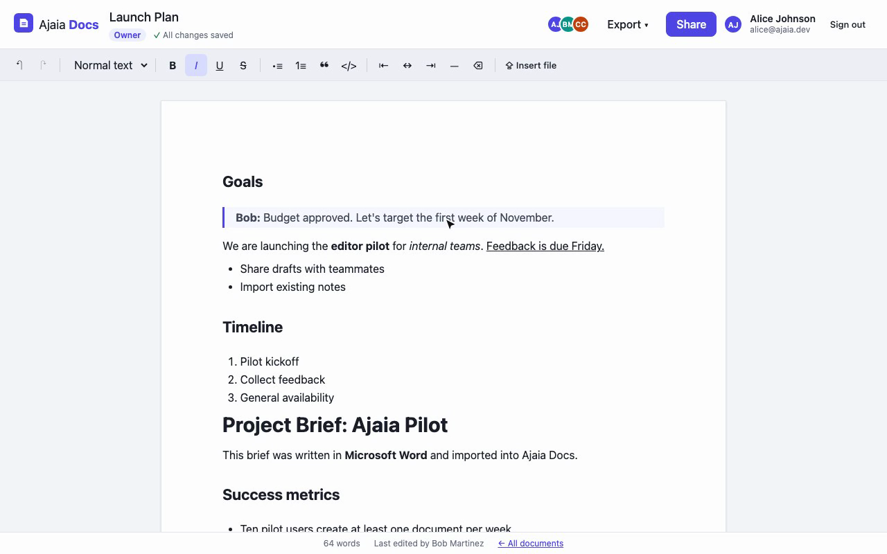

# Ajaia Docs

A lightweight collaborative document editor: create, edit, import and share rich‑text documents, with persistence and owner/editor/viewer access control.

- **Live app:** _see `SUBMISSION.md` (Live URL)_
- **Walkthrough video (4:32):** [https://drive.google.com/file/d/1xrYKcF4SgEHFb2ON5023OKuqjVjcpWG0/view?usp=sharing](https://drive.google.com/file/d/1xrYKcF4SgEHFb2ON5023OKuqjVjcpWG0/view?usp=sharing)
- **Submission folder (Google Drive):** [https://drive.google.com/drive/folders/1RZqpQvz2jbQ_8LMnaT5QlWhg93tagQBm?usp=sharing](https://drive.google.com/drive/folders/1RZqpQvz2jbQ_8LMnaT5QlWhg93tagQBm?usp=sharing)
- **Source code:** https://github.com/amartya1523/Ajaia-LLC
- **Architecture note:** [`docs/ARCHITECTURE.md`](docs/ARCHITECTURE.md)
- **AI workflow note:** [`docs/AI_WORKFLOW.md`](docs/AI_WORKFLOW.md)



## Demo accounts

Authentication is simulated: pick a seeded account on the login screen (no passwords).

| User | Email | Seeded data |
|---|---|---|
| Alice Johnson | `alice@ajaia.dev` | Owns **Q4 Product Planning**, shared with Bob as *editor* |
| Bob Martinez | `bob@ajaia.dev` | Owns **Bob's meeting notes**; sees Alice's doc under *Shared with me* |
| Carol Chen | `carol@ajaia.dev` | Nothing shared yet; use her to test *viewer* and *no access* |

**Suggested review flow (2 minutes):** sign in as Alice → create a document and format it → *Share* it with Carol as **Can view** → sign out → sign in as Carol → open it from *Shared with me* (read‑only) → try opening the URL of a doc not shared with her (you'll get "Can't open this document").

## Features

| Area | What works |
|---|---|
| Documents | Create, rename (inline title), edit, delete (owner only), autosave with status indicator, ⌘/Ctrl+S, reopen after refresh |
| Rich text | Headings H1–H3, bold, italic, underline, strikethrough, bulleted & numbered lists, quotes, code blocks, alignment, divider, undo/redo, Markdown shortcuts (`## `, `- `, `1. `, `> `) |
| File upload | **Import a file → new document** (dashboard, drag & drop or browse) and **Insert file → at cursor** (editor). Supported: `.txt`, `.md`/`.markdown`, `.docx`, max 2 MB. Other types are rejected with a clear message |
| Sharing | Owner shares by email as **Can edit** or **Can view**, changes role, revokes. Dashboard tabs: *All / Owned by me / Shared with me* with role badges |
| Access control | Enforced server‑side: viewers get `403` on writes, users without access get `404` (no ID leakage), only owners manage sharing or delete |
| Collaboration (light) | Open documents poll every 4s and pull other people's saves ("Updated by Bob"). Saves carry a version; stale writes get `409` and the user chooses *Load their version* or *Overwrite with mine* |
| Export (stretch) | Markdown, HTML, or Print / Save as PDF |

## Run locally

Requires **Node.js 22.13+** (uses the built‑in `node:sqlite`; no native modules to compile).

```bash
npm install
npm run build      # build the React app into dist/
npm start          # http://localhost:3001 (API + app); seeds demo data on first run
```

Development mode with hot reload (API on :3001, Vite on :5173 with `/api` proxied):

```bash
npm run dev
```

Run the tests:

```bash
npm test
```

Configuration (all optional): `PORT` (default `3001`), `DB_PATH` (default `./data/ajaia.db`). Delete the DB file to reset to the seeded state.

Sample files for testing upload are in [`samples/`](samples/): `meeting-notes.md`, `plain-notes.txt`, `project-brief.docx`.

## Deployment

The app is a single Node service, so any Node 22 host works.

- **Render (free):** *New → Blueprint* → select this repo. `render.yaml` defines the build (`npm ci --include=dev && npm run build`) and start (`npm start`) commands.
- **Docker:** `docker build -t ajaia-docs . && docker run -p 3001:3001 ajaia-docs`

> On free hosting tiers the filesystem is ephemeral: the SQLite file resets when the instance restarts or redeploys, and demo data is re‑seeded automatically. For production I'd move to Postgres (see the architecture note).

## Project structure

```
server/
  index.js      entry: opens DB, seeds, serves API + built app
  app.js        Express app: auth, documents, sharing, import/export, error handling
  db.js         SQLite schema (node:sqlite)
  content.js    file → HTML conversion (.txt/.md/.docx), sanitization, HTML → Markdown
  seed.js       demo users + documents
src/
  pages/        LoginPage, Dashboard, EditorPage (autosave, polling, conflict UI)
  components/   Toolbar, ShareDialog, Toast, Header, Avatar
tests/
  api.test.js   API integration tests (Vitest + Supertest, in-memory SQLite)
samples/        files for trying the upload flow
scripts/walkthrough/  scripts that recorded the walkthrough video (Playwright + TTS + ffmpeg)
```

## API summary

| Method | Path | Access |
|---|---|---|
| `POST` | `/api/auth/login` · `/api/auth/logout` · `GET /api/auth/me` | — |
| `GET` | `/api/documents` → `{ owned, shared }` | signed in |
| `POST` | `/api/documents` | signed in |
| `GET` | `/api/documents/:id` | viewer+ |
| `PATCH` | `/api/documents/:id` `{ title?, content?, baseVersion?, force? }` | editor+ |
| `DELETE` | `/api/documents/:id` | owner |
| `POST` / `DELETE` | `/api/documents/:id/shares[/:userId]` | owner |
| `POST` | `/api/documents/import` (multipart `file`) → new doc | signed in |
| `POST` | `/api/documents/:id/import` (multipart `file`) → `{ html }` | editor+ |
| `GET` | `/api/documents/:id/export?format=md\|html` | viewer+ |

## Status

**Working end to end:** everything in the feature table above, verified by automated tests and by driving the app in a browser.

**Incomplete / intentionally out of scope:** real authentication (passwords/OAuth), true real‑time co‑editing (CRDT/OT, live cursors), comments, version history, images and tables inside documents, durable storage on the free hosting tier.

**Next 2–4 hours:** version history with restore (snapshot on save, list + diff + restore), then presence indicators ("Bob is viewing") over WebSockets replacing polling, then a Playwright UI smoke test in CI.
